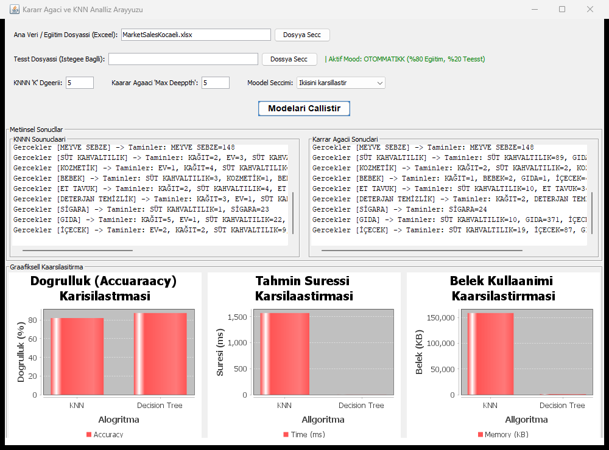
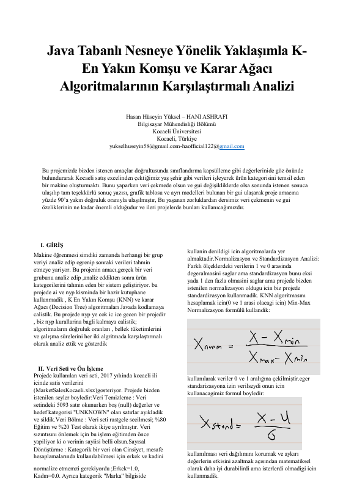
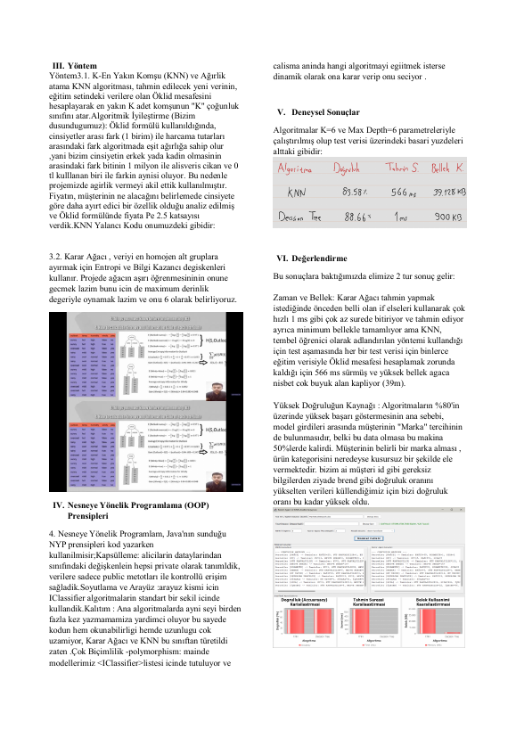
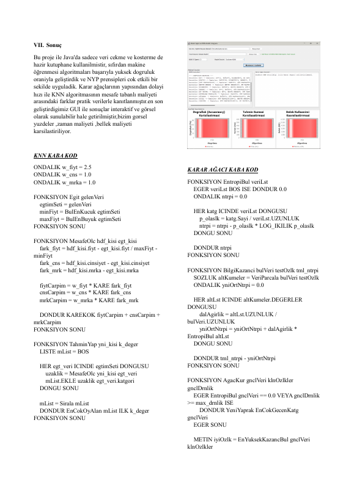
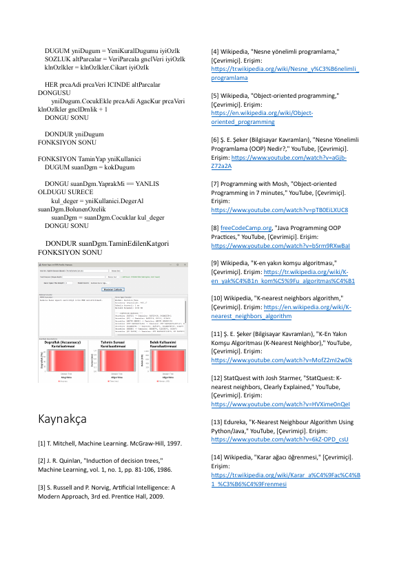

# KNN vs decision tree, object-oriented comparison (Java)

A Java implementation of a k-nearest-neighbour classifier and a decision tree, compared on a market-sales dataset.

## Context

Coursework for the Programming Laboratory (Prolab) course, Computer Engineering, Kocaeli University - Spring 2026, project 2.

## What it does

- Reads `MarketSalesKocaeli.xlsx` with Apache POI
- Pre-processing, a common `IClassifier` interface, KNN and decision-tree classifiers, an evaluator
- Swing GUI (`MainGUI`) and a `results.json` summary

## Build / run

```
mvn package
java -cp target/classes com.mycompany.javakararagaci.JavaKararAgaci
```
Requires JDK and Maven.

## Report

The full project report (PDF) is in `docs/report.pdf`.

## Notes

No API keys, tokens or credentials are used or stored in this repository.

## Screenshot



Verified: builds with Maven (JDK 24+; Apache POI, Gson and JFreeChart are downloaded automatically) and the GUI runs the KNN and decision-tree models on the sample data.

## Report pages

Full report: [docs/report.pdf](docs/report.pdf)






